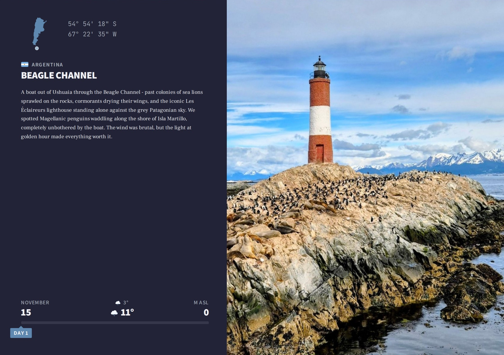
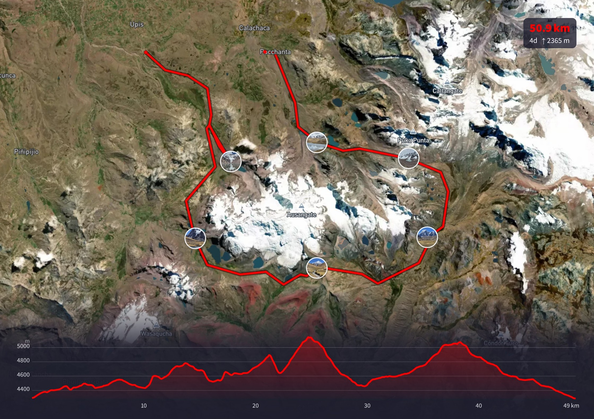
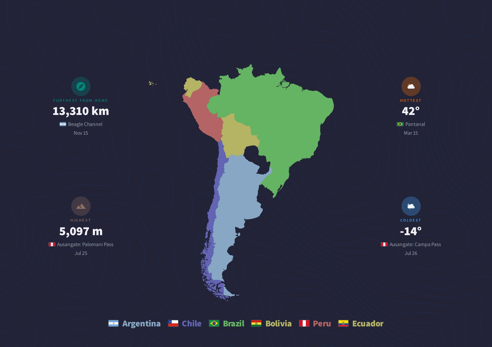
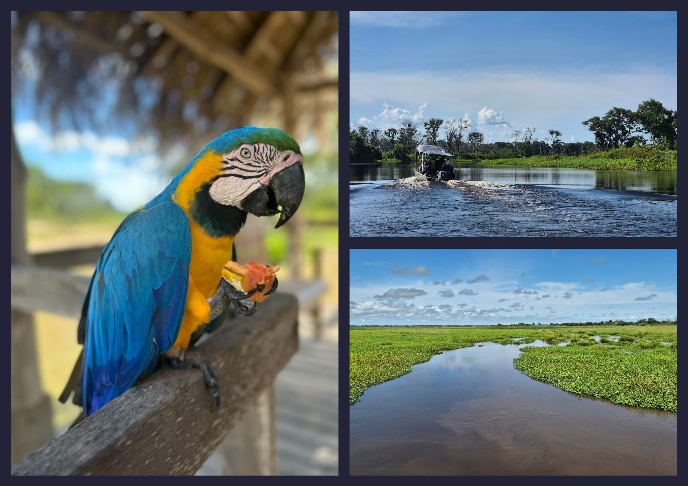

<p align="center">
  
</p>

<h1 align="center">Wanderbound</h1>

<p align="center"><a href="https://wanderbound.raveh.dev">https://wanderbound.raveh.dev</a></p>

<p align="center">
  Turn a <a href="https://www.polarsteps.com/">Polarsteps</a> data export into an amazing album, exported as a PDF you can print yourself!
</p>

<p align="center">
  <a href="https://github.com/itay-raveh/wanderbound/actions/workflows/ci.yml"></a>
  <a href="https://github.com/itay-raveh/wanderbound/releases"></a>
  <a href="https://github.com/itay-raveh/wanderbound/blob/main/LICENSE"></a>
</p>

<p align="center">
  
</p>

- Start from an intelligently laid out album, then edit with full freedom, including all fonts and colors
- Backfill enhanced weather and elevation data, and automatically recognizes known mountain peaks
- Upgrade compressed Polarsteps photos with originals from your device or Google Photos
- Add maps with your GPS data. Automatically recognizes hikes, flights, and roads
- Include your videos in the album by selecting one poster frame, right within our editor
- Look around phone panoramas, choose their framing, and lay them out across one or two full pages
- Full RTL and localization support

<p align="center">
  &nbsp;
  &nbsp;
  
</p>

## Self-Hosting

You can see [the setup for the public instance](https://github.com/itay-raveh/infra) for inspiration.

### Kubernetes

We provide a Helm chart, see the [installation guide](charts/wanderbound/README.md).

### Docker Compose

[mise](https://mise.jdx.dev/) manages tool versions and all project commands. Install it, then:

```bash
git clone https://github.com/itay-raveh/wanderbound.git
cd wanderbound

mise run setup
```

Fill in the values in the created `.env` file.

When OAuth sign-ins are unconfigured, the landing page offers local accounts.
Anyone who can access the installation can use these accounts, so keep this mode on a trusted network or behind access controls.
Configuring either sign-in provider disables the local account picker.

Run at <https://localhost:8000>:

```bash
docker compose up -d
```

This will spin up Wanderbound, PostgresSQL, and Garage (S3).

For production, set `ENVIRONMENT=production`, `APP_VERSION` to one of our [tags](https://github.com/itay-raveh/wanderbound/tags), and `DOMAIN`, then use:

```bash
docker compose -f compose.yml up -d
```
